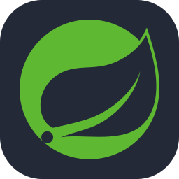
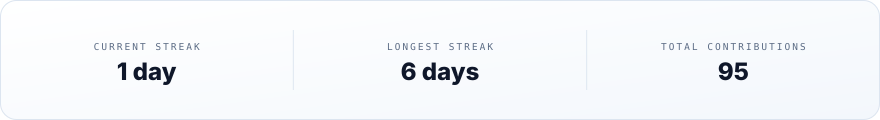

<!--
  ┌───────────────────────────────────────────────────────────────┐
  │  You found the source. Nice.                                  │
  │  Every animated visual here is a hand-built SVG (SMIL only —  │
  │  GitHub strips scripts, not motion). Each one ships in two    │
  │  skins; <picture> picks yours. The snake regrows nightly.     │
  └───────────────────────────────────────────────────────────────┘
-->

<picture>
  <source media="(prefers-color-scheme: dark)" srcset="assets/hero-dark.svg">
  
</picture>

 &nbsp; 

## About

<table>
  <tr>
    <td width="50%" valign="top">
      <b>🎨 Front end</b> 
      React — interfaces in TypeScript &amp; JavaScript that stay fast and accessible.
    </td>
    <td width="50%" valign="top">
      <b>⚙️ Back end</b> 
      Spring Boot, Django &amp; Laravel — APIs in Java, Python &amp; PHP, built to last.
    </td>
  </tr>
  <tr>
    <td valign="top">
      <b>🗄️ Databases</b> 
      MySQL &amp; PostgreSQL — modeled, indexed and migration-ready.
    </td>
    <td valign="top">
      <b>🚀 DevOps</b> 
      Docker, Kubernetes &amp; GitHub Actions — from commit to cluster.
    </td>
  </tr>
</table>

> *“I build web applications end-to-end and deploy them with Docker & Kubernetes.”*

<picture>
  <source media="(prefers-color-scheme: dark)" srcset="assets/pulse-dot-dark.svg">
  
</picture> <b>🔭 Currently building</b> — <a href="https://github.com/Maki99-99/deploiement"><code>deploiement</code></a>, a full-stack user-management app running on Kubernetes.

## Stack

  <b>Front end</b> 
  
  
  

  <b>Back end</b> 
  
  
  
  
  
  

  <b>Databases</b> 
  
  

  <b>DevOps &amp; tooling</b> 
  
  
  
  

  <picture>
    <source media="(prefers-color-scheme: dark)" srcset="assets/divider-dark.svg">
    
  </picture>

## Projects

### deploiement

**Full-stack user management — containerized and deployed on Kubernetes.**  
Angular 16 talks to a Spring Boot 3 API backed by MySQL 8. Everything ships as Docker images and runs on Kubernetes Deployments and Services, configured through a ConfigMap and a Secret, exposed through an NGINX Ingress.

  <picture>
    <source media="(prefers-color-scheme: dark)" srcset="assets/deploiement-arch-dark.svg">
    
  </picture>

  
  
  
  
  

  <picture>
    <source media="(prefers-color-scheme: dark)" srcset="assets/divider-dark.svg">
    
  </picture>

## GitHub stats

<!-- github-stats, top-langs and streak cards are generated by scripts/generate-assets.mjs in .github/workflows/update-assets.yml — do not hand-edit the /assets copies. -->

  <picture>
    <source media="(prefers-color-scheme: dark)" srcset="assets/github-stats-dark.svg">
    
  </picture>

  <picture>
    <source media="(prefers-color-scheme: dark)" srcset="assets/top-langs-dark.svg">
    
  </picture>

  <picture>
    <source media="(prefers-color-scheme: dark)" srcset="assets/streak-dark.svg">
    
  </picture>

### Contribution snake

<!-- Regenerated by .github/workflows/update-assets.yml — see CHANGELOG.md before editing. -->

  <picture>
    <source media="(prefers-color-scheme: dark)" srcset="assets/snake-dark.svg">
    
  </picture>

  <picture>
    <source media="(prefers-color-scheme: dark)" srcset="assets/divider-dark.svg">
    
  </picture>

Building full-stack apps, one deploy at a time · Génie Logiciel

