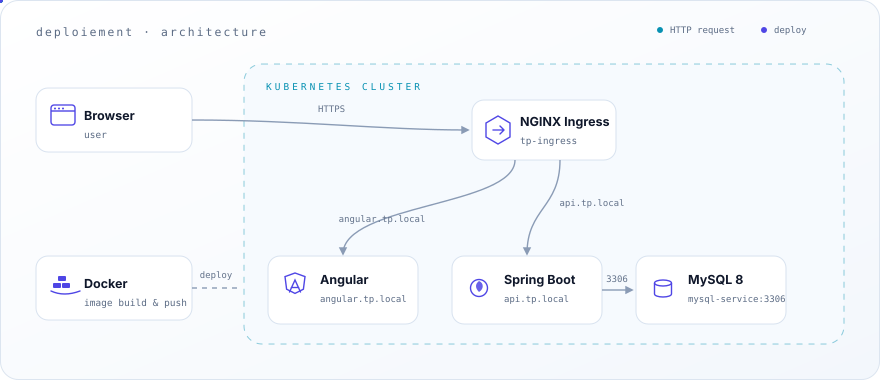
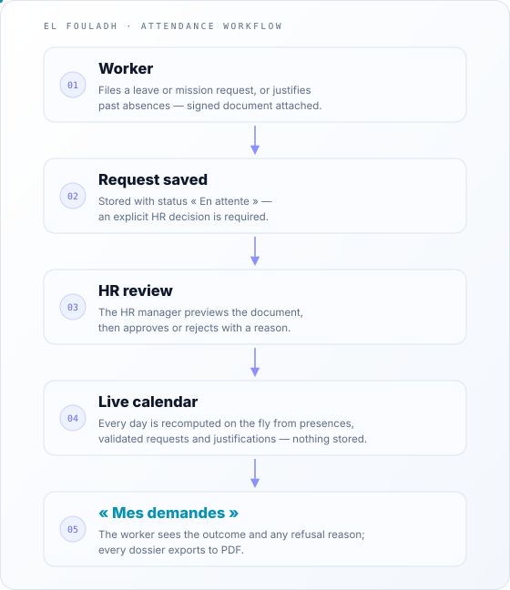
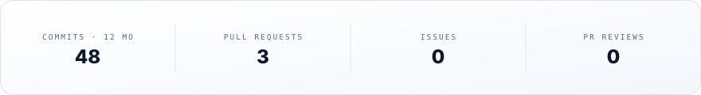
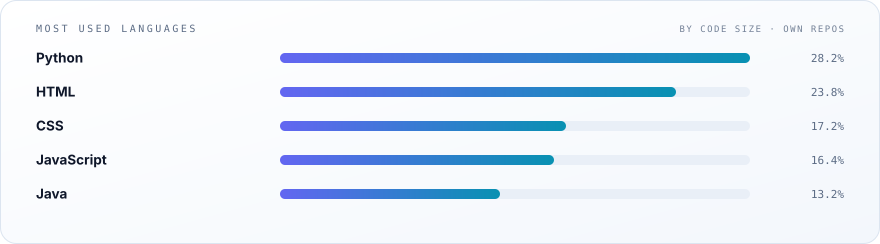
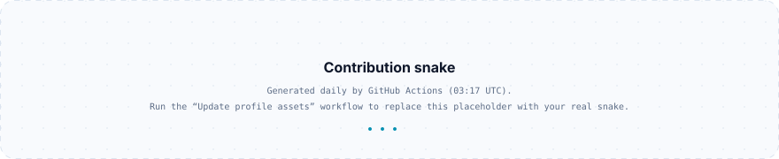

<!--
  ┌───────────────────────────────────────────────────────────────┐
  │  You found the source. Nice.                                  │
  │  Every animated visual here is a hand-built SVG (SMIL only —  │
  │  GitHub strips scripts, not motion). Each one ships in two    │
  │  skins; <picture> picks yours. The snake regrows nightly.     │
  └───────────────────────────────────────────────────────────────┘
-->

<picture>
  <source media="(prefers-color-scheme: dark)" srcset="assets/hero-dark.svg">
  
</picture>

 &nbsp; 

## About

<table>
  <tr>
    <td width="50%" valign="top">
      <b>🎨 Front end</b> 
      React — interfaces in TypeScript &amp; JavaScript that stay fast and accessible.
    </td>
    <td width="50%" valign="top">
      <b>⚙️ Back end</b> 
      Spring Boot, Django &amp; Laravel — APIs in Java, Python &amp; PHP, built to last.
    </td>
  </tr>
  <tr>
    <td valign="top">
      <b>🗄️ Databases</b> 
      MySQL &amp; PostgreSQL — modeled, indexed and migration-ready.
    </td>
    <td valign="top">
      <b>🚀 DevOps</b> 
      Docker, Kubernetes &amp; GitHub Actions — from commit to cluster.
    </td>
  </tr>
</table>

> *“I build web applications end-to-end and deploy them with Docker & Kubernetes.”*

**🔭 Currently building** — [`deploiement`](https://github.com/Maki99-99/deploiement), a full-stack user-management app running on Kubernetes.

## Stack

<table>
  <tr>
    <td align="right"><b>Front end</b></td>
    <td>
      <picture>
        <source media="(prefers-color-scheme: dark)" srcset="https://skillicons.dev/icons?i=react,ts,js&amp;theme=dark">
        
      </picture>
    </td>
  </tr>
  <tr>
    <td align="right"><b>Back end</b></td>
    <td>
      <picture>
        <source media="(prefers-color-scheme: dark)" srcset="https://skillicons.dev/icons?i=spring,django,laravel,java,py,php&amp;theme=dark">
        
      </picture>
    </td>
  </tr>
  <tr>
    <td align="right"><b>Databases</b></td>
    <td>
      <picture>
        <source media="(prefers-color-scheme: dark)" srcset="https://skillicons.dev/icons?i=mysql,postgres&amp;theme=dark">
        
      </picture>
    </td>
  </tr>
  <tr>
    <td align="right"><b>DevOps &amp; tooling</b></td>
    <td>
      <picture>
        <source media="(prefers-color-scheme: dark)" srcset="https://skillicons.dev/icons?i=docker,kubernetes,git,github&amp;theme=dark">
        
      </picture>
    </td>
  </tr>
</table>

## Projects

### deploiement

**Full-stack user management — containerized and deployed on Kubernetes.**  
Angular 16 talks to a Spring Boot 3 API backed by MySQL 8. Everything ships as Docker images and runs on Kubernetes Deployments and Services, configured through a ConfigMap and a Secret, exposed through an NGINX Ingress.

  <picture>
    <source media="(prefers-color-scheme: dark)" srcset="assets/deploiement-arch-dark.svg">
    
  </picture>

  
  
  
  
  

### El Fouladh — Attendance Management

**Attendance, leave & mission management for a steel plant — paper forms replaced by a bilingual Django web app.**  
Workers file leave and mission requests or justify past absences; the HR manager approves or rejects each dossier with a reason; a ZKTeco punch clock feeds the attendance engine; reports export to PDF.

  
  
  
  

  <picture>
    <source media="(prefers-color-scheme: dark)" srcset="assets/elfouladh-flow-dark.svg">
    
  </picture>

## GitHub stats

<!-- github-stats, top-langs and stats-card are generated by scripts/generate-assets.mjs in .github/workflows/update-assets.yml — do not hand-edit the /assets copies. -->

  <picture>
    <source media="(prefers-color-scheme: dark)" srcset="assets/github-stats-dark.svg">
    
  </picture>

  <picture>
    <source media="(prefers-color-scheme: dark)" srcset="assets/top-langs-dark.svg">
    
  </picture>

  <picture>
    <source media="(prefers-color-scheme: dark)" srcset="https://streak-stats.demolab.com/?user=Maki99-99&amp;background=0B1220&amp;border=23304F&amp;stroke=23304F&amp;ring=818CF8&amp;fire=22D3EE&amp;currStreakNum=E6EDF7&amp;sideNums=E6EDF7&amp;currStreakLabel=818CF8&amp;sideLabels=8CA3C7&amp;dates=64748B">
    
  </picture>

### Contribution snake

<!-- Regenerated by .github/workflows/update-assets.yml — see CHANGELOG.md before editing. -->

  <picture>
    <source media="(prefers-color-scheme: dark)" srcset="assets/snake-dark.svg">
    
  </picture>

  <picture>
    <source media="(prefers-color-scheme: dark)" srcset="assets/stats-card-dark.svg">
    
  </picture>

  <picture>
    <source media="(prefers-color-scheme: dark)" srcset="assets/divider-dark.svg">
    
  </picture>

Building full-stack apps, one deploy at a time · Génie Logiciel

