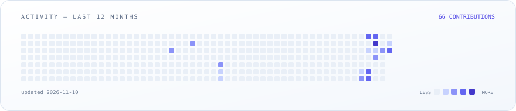

<!--
  ┌───────────────────────────────────────────────────────────────┐
  │  You found the source. Nice.                                  │
  │  Every animated visual here is a hand-built SVG (SMIL only —  │
  │  GitHub strips scripts, not motion). Each one ships in two    │
  │  skins; <picture> picks yours. The snake regrows nightly.     │
  └───────────────────────────────────────────────────────────────┘
-->

<picture>
  <source media="(prefers-color-scheme: dark)" srcset="https://raw.githubusercontent.com/Maki99-99/Maki99-99/main/assets/hero-dark.svg">
  
</picture>

 &nbsp; 

## About

<table>
  <tr>
    <td width="50%" valign="top">
      <b>🎨 Front end</b> 
      Angular &amp; React — interfaces in TypeScript &amp; JavaScript that stay fast and accessible.
    </td>
    <td width="50%" valign="top">
      <b>⚙️ Back end</b> 
      Spring Boot, Django &amp; Laravel — APIs in Java, Python &amp; PHP, built to last.
    </td>
  </tr>
  <tr>
    <td valign="top">
      <b>🗄️ Databases</b> 
      MySQL &amp; PostgreSQL — modeled, indexed and migration-ready.
    </td>
    <td valign="top">
      <b>🚀 DevOps</b> 
      Docker, Kubernetes &amp; GitHub Actions — from commit to cluster.
    </td>
  </tr>
</table>

> *“I build web applications end-to-end and deploy them with Docker & Kubernetes.”*

**🔭 Currently building** — [`deploiement`](https://github.com/Maki99-99/deploiement), a full-stack user-management app running on Kubernetes; the next two projects are on the bench.

## Stack

<b>Front end</b> 
<picture>
  <source media="(prefers-color-scheme: dark)" srcset="https://skillicons.dev/icons?i=angular,react,ts,js&amp;theme=dark">
  
</picture>

  

<b>Back end</b> 
<picture>
  <source media="(prefers-color-scheme: dark)" srcset="https://skillicons.dev/icons?i=spring,django,laravel,java,py,php&amp;theme=dark">
  
</picture>

  

<b>Databases</b> 
<picture>
  <source media="(prefers-color-scheme: dark)" srcset="https://skillicons.dev/icons?i=mysql,postgres&amp;theme=dark">
  
</picture>

  

<b>DevOps &amp; tooling</b> 
<picture>
  <source media="(prefers-color-scheme: dark)" srcset="https://skillicons.dev/icons?i=docker,kubernetes,git,githubactions,github&amp;theme=dark">
  
</picture>

## Featured project

### deploiement

**Full-stack user management — containerized and deployed on Kubernetes.**  
Angular 16 talks to a Spring Boot 3 API backed by MySQL 8. Everything ships as Docker images and runs on Kubernetes Deployments and Services, configured through a ConfigMap and a Secret, exposed through an NGINX Ingress.

  <picture>
    <source media="(prefers-color-scheme: dark)" srcset="https://raw.githubusercontent.com/Maki99-99/Maki99-99/main/assets/deploiement-arch-dark.svg">
    
  </picture>

  
  
  
  
  

### Next in the lab

| Project | Pitch | Stack |
| :-- | :-- | :-- |
| **Project 02** *(placeholder)* | _One-line pitch — what it does, for whom, why it matters._ | _e.g. Laravel · MySQL_ |
| **Project 03** *(placeholder)* | _One-line pitch._ | _e.g. Django · PostgreSQL_ |

## GitHub stats

  <picture>
    <source media="(prefers-color-scheme: dark)" srcset="https://raw.githubusercontent.com/Maki99-99/Maki99-99/main/assets/trophies-dark.svg">
    
  </picture>

  <picture>
    <source media="(prefers-color-scheme: dark)" srcset="https://github-readme-stats.vercel.app/api?username=Maki99-99&amp;show_icons=true&amp;include_all_commits=true&amp;rank_icon=github&amp;bg_color=0B1220&amp;title_color=818CF8&amp;text_color=E6EDF7&amp;icon_color=22D3EE&amp;border_color=23304F">
    
  </picture>
  <picture>
    <source media="(prefers-color-scheme: dark)" srcset="https://github-readme-stats.vercel.app/api/top-langs/?username=Maki99-99&amp;layout=compact&amp;langs_count=8&amp;bg_color=0B1220&amp;title_color=818CF8&amp;text_color=E6EDF7&amp;border_color=23304F">
    
  </picture>

  <picture>
    <source media="(prefers-color-scheme: dark)" srcset="https://streak-stats.demolab.com/?user=Maki99-99&amp;background=0B1220&amp;border=23304F&amp;stroke=23304F&amp;ring=818CF8&amp;fire=22D3EE&amp;currStreakNum=E6EDF7&amp;sideNums=E6EDF7&amp;currStreakLabel=818CF8&amp;sideLabels=8CA3C7&amp;dates=64748B">
    
  </picture>

  <picture>
    <source media="(prefers-color-scheme: dark)" srcset="https://raw.githubusercontent.com/Maki99-99/Maki99-99/main/assets/activity-dark.svg">
    
  </picture>

### Contribution snake

<!-- Regenerated by .github/workflows/update-assets.yml — see CHANGELOG.md before editing. -->

  <picture>
    <source media="(prefers-color-scheme: dark)" srcset="https://raw.githubusercontent.com/Maki99-99/Maki99-99/main/assets/snake-dark.svg">
    
  </picture>

  <picture>
    <source media="(prefers-color-scheme: dark)" srcset="https://raw.githubusercontent.com/Maki99-99/Maki99-99/main/assets/stats-card-dark.svg">
    
  </picture>

  <picture>
    <source media="(prefers-color-scheme: dark)" srcset="https://raw.githubusercontent.com/Maki99-99/Maki99-99/main/assets/divider-dark.svg">
    
  </picture>

Building full-stack apps, one deploy at a time · Génie Logiciel

